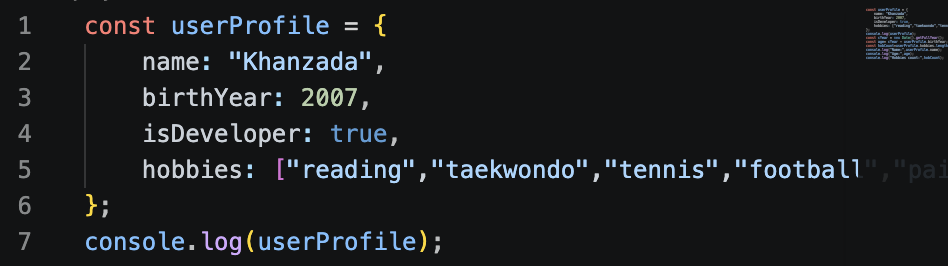
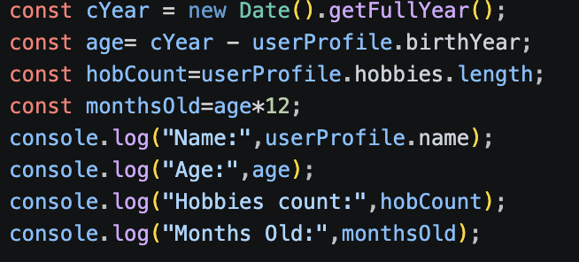
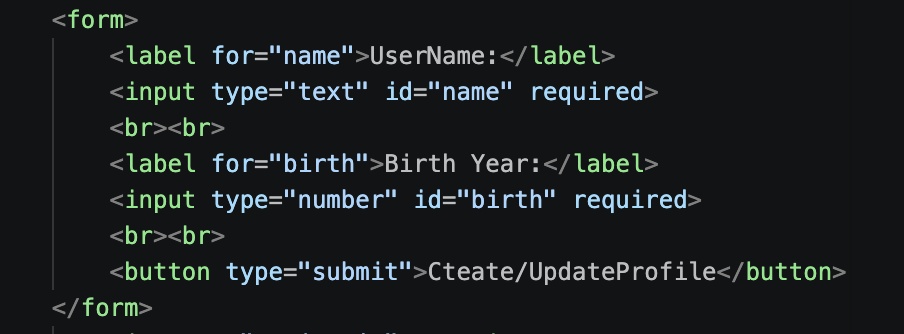
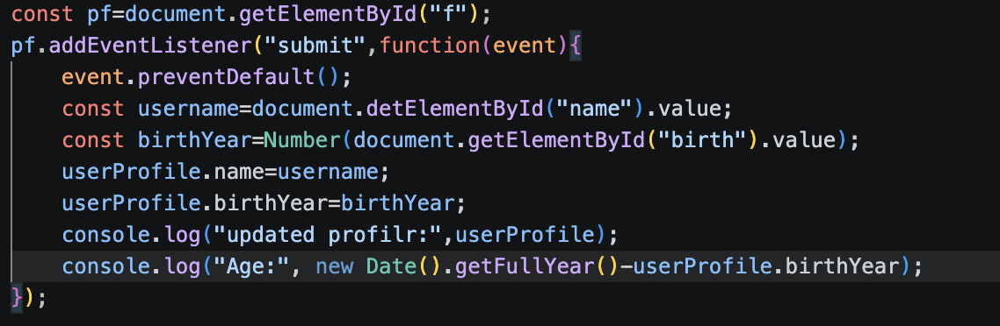
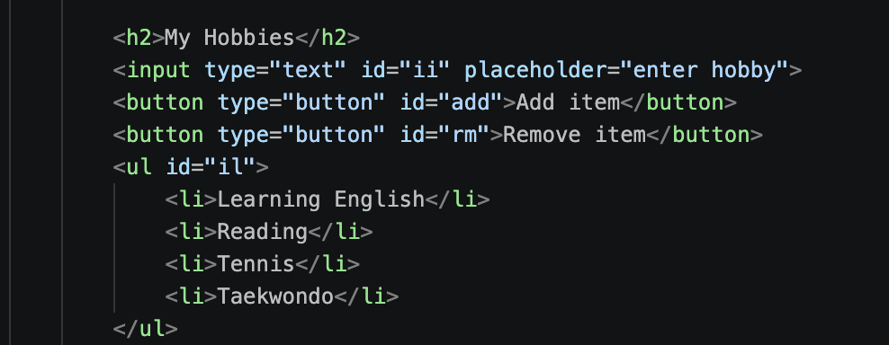
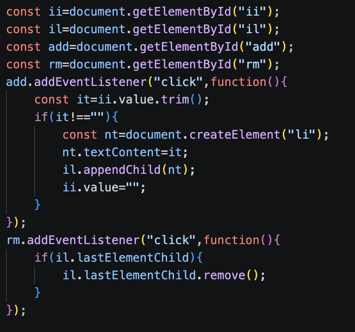

# Assignment 5: JavaScript Basics — DOM Manipulation & Events

**Student Name:** Khanzada Nyshanbek  
**Group:** [Your Group]

Part 1: Profile Object, Data Types & Arithmetic

Task 1. The Personal Info Object:
o	Create a JavaScript const object named userProfile that stores various data types: 
•	string (name), 
•	number (birthYear), 
•	boolean (isDeveloper), 
•	an array (hobbies).

Task 2. Arithmetic Calculations:
o	Write a script that uses arithmetic operators to calculate the user's current age dynamically (e.g., current year minus birthYear).
o	Calculate another metric, such as how many months old they are or total hobbies count, and display these values in the console or on the page.

Part 2. Form Input & Event Responses

Task 3. HTML Form Setup: 
Create a simple form or input fields containing:
o	An input for Username
o	An input for Birth Year
o	A "Create / Update Profile" submit button.

Task 4. Event Listener: 	
Add a click or submit event listener to the button. When clicked, capture the user's input values and update your userProfile object.

Part 3: DOM List Manipulation 

Task 5. Creating & Removing Elements
•	Create an unordered list (<ul>) representing your tasks or hobbies.
•	Create an "Add Item" button that lets the user input and add a new <li> item to the list.
•	Create a "Remove Item" button that deletes the last item from the list

## Conclusion

In this assignment, I practiced JavaScript objects, data types, arithmetic operations, HTML forms, event listeners, and DOM manipulation. I learned how to update object properties using user input and dynamically add or remove HTML elements using JavaScript.